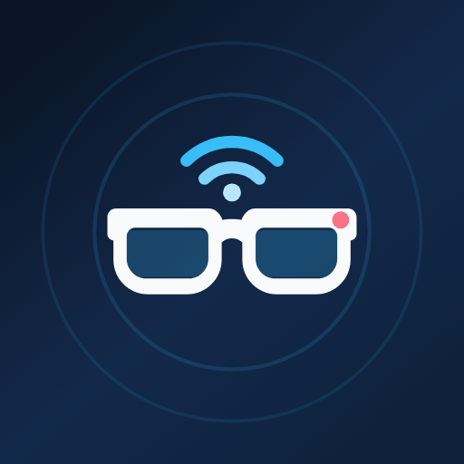

<p align="center">
  <a href="https://play.google.com/store/apps/details?id=com.windyflow.smartglassscanner">
    
  </a>
</p>

<h1 align="center">SmartGlass Scanner</h1>

<p align="center">
  <a href="README.md">한국어</a> | <strong>English</strong>
</p>

<p align="center">
  <a href="https://play.google.com/store/apps/details?id=com.windyflow.smartglassscanner">
    
  </a>
</p>

<p align="center">
  <a href="https://yusulike.github.io/smartglass-scanner/">App Homepage</a> ·
  <a href="https://play.google.com/store/apps/details?id=com.windyflow.smartglassscanner">Install on Google Play</a>
</p>

**SmartGlass Scanner** (`com.windyflow.smartglassscanner`) is a **BLE-only (no location permission)** native Android app that continuously detects BLE advertising packets from nearby smart glasses (Ray-Ban Meta, Snap Spectacles, HeyCyan SDK, etc.) in the background, with false-positive minimization filtering and a Gate Screening mode for exam halls and secure areas.

---

## Key Features

1. **Always-On Proximity Detection Mode (`BACKGROUND_GUARD`)**
   * **Foreground / Background Scan Mode Split**: Runs an unfiltered `SCAN_MODE_BALANCED` scan while the app is visible to capture device-name patterns and Scan Responses broadly, and automatically switches to `SCAN_MODE_LOW_POWER` with hardware `ScanFilter`s (Company ID / Service UUID / Service Data / Android 13+ device-name prefix) when idle in the background.
   * **False-Positive Signal Filtering (`BleSignalFilter`)**: Applies EMA RSSI smoothing (`α = 0.3`), hysteresis (`8 dBm` gap), and an 8-second sliding-window **flexible N-of-M** threshold (`HIGH = 1 hit`, `MEDIUM = 2 hits`, `LOW = 3 hits`), distinguishing alerts for camera-equipped (`CAMERA`) and display-only AR (`DISPLAY_AR`) glasses.
   * **Whitelist & Cooldown**: Permanently ignore whitelisted devices, configurable per-device alert cooldown (`5–60s`, default `10s`), and automatic cleanup of devices unseen for 120 seconds.
   * **Persistent Local Logging & Export**: Persists up to 500 entries — both confirmed alerts and sub-threshold `[OBSERVED]` hits (per-device throttled) — locally in `files/detection_logs.json` across restarts, and exports `.txt` reports via Android SAF (`CreateDocument`) with zero external server transmission.
2. **Gate Screening Mode (`GATE_SCREENING`)**
   * Foreground-only `SCAN_MODE_LOW_LATENCY` close-proximity (`≥ -55 dBm`, approx. 0.5–1m) instant screening mode for exam proctors and security checkpoints.
   * Fast EMA (`α = 0.7`), instant 3-level verdict (`CLEAR` green / `CAUTION` amber / `ALERT` red), `2s` cooldown silent vibration (`VIBRATE`), and a **Next Candidate (Reset)** button.
3. **Signature DB + Custom User Hex IDs**
   * Dynamically merges built-in signatures from [signatures.json](app/src/main/assets/signatures.json) with user-defined 16-bit Company IDs (`0x0000`–`0xFFFF`) stored in DataStore via a live `Flow` to rebuild `ScanFilter`s on the fly.
4. **Google Play v1.0 BLE-Only Policy Compliance**
   * Declares `neverForLocation` on `BLUETOOTH_SCAN` for Android 12+ (API 31+), operating without requesting `ACCESS_FINE_LOCATION` at runtime (`maxSdkVersion="30"` retained only for legacy compatibility).
   * Provides a persistent Android 14+ `connectedDevice` foreground service notification with an immediate **Stop Scan** action.

---

## Detectable Devices & Signatures (25 Built-in)

Based on the 25 signatures defined in [signatures.json](app/src/main/assets/signatures.json). Additional custom 16-bit Hex Company IDs (`0x0000`–`0xFFFF`, `LOW` confidence / 3 hits) can be registered in Settings.

| # | Signature ID | Display Label | Matching Rule (`Company ID` / `Service UUID` / `Service Data` / Device Name) | Category | Confidence (Guard Hits / Gate) | Scope & Notes |
|:-:|:---|:---|:---|:---:|:---|:---|
| 1 | `meta_rayban_tech` | Ray-Ban Meta (Meta Platforms Tech) | Company ID `0x058E` + Payload ASCII `META_RB_GLASS` | `CAMERA` | `HIGH` (1 hit / `ALERT`) | Excludes Quest VR (`META_QUEST_3`) false positives |
| 2 | `meta_rayban_inc_confirmed` | Ray-Ban Meta (Meta Platforms Inc) | Company ID `0x01AB` + Payload ASCII `META_RB_GLASS` | `CAMERA` | `HIGH` (1 hit / `ALERT`) | Promotes shared `0x01AB` immediately on payload match |
| 3 | `luxottica_rayban` | Ray-Ban Meta Frame (Luxottica) | Company ID `0x0D53` | `CAMERA` | `HIGH` (1 hit / `ALERT`) | Always active (background & foreground) |
| 4 | `meta_platforms_general` | Meta Platforms Device | Company ID `0x01AB` | `CAMERA` | `LOW` (3 hits / `CAUTION`) | Includes general Meta BLE devices (caution) |
| 5 | `snap_spectacles` | Snap Spectacles | Company ID `0x03C2` | `CAMERA` | `MEDIUM` (2 hits / `ALERT`) | Always active (background & foreground) |
| 6 | `tcl_rayneo` | TCL / RayNeo Smart Glasses | Company ID `0x0BC6` | `CAMERA` | `MEDIUM` (2 hits / `ALERT`) | Always active (background & foreground) |
| 7 | `meizu_myvu` | Meizu MYVU AR Glasses | Company ID `0x03AB` | `DISPLAY_AR` | `MEDIUM` (2 hits / `ALERT`) | Distinct non-camera display AR alert |
| 8 | `zhuhai_jieli` | Zhuhai Jieli Chipset Glasses | Company ID `0x05D6` | `CAMERA` | `LOW` (3 hits / `CAUTION`) | Generic Chinese glasses/audio chipset (caution) |
| 9 | `heycyan_sdk` | HeyCyan SDK Smart Glasses | Service UUID `7905FFF0-B5CE-4E99-A40F-4B1E122D00D0` | `CAMERA` | `HIGH` (1 hit / `ALERT`) | GATT Service UUID match |
| 10 | `rokid_ai_glasses` | Rokid AI Glasses | Service UUID `00009100-0000-1000-8000-00805F9B34FB` (`0x9100`) | `CAMERA` | `HIGH` (1 hit / `ALERT`) | GATT Service UUID match |
| 11 | `da_echo_glasses` | Da Echo Smart Glasses | Service UUID `0xFEA8` + Service Data Hex `413149010000` | `CAMERA` | `HIGH` (1 hit / `ALERT`) | Service Data byte verification |
| 12 | `heycyan_name_prefix` | HeyCyan Smart Glasses (Name Prefix) | Name prefix `HeyCyan-` (case-insensitive) | `CAMERA` | `MEDIUM` (2 hits / `ALERT`) | Foreground + Android 13+ background (`0x09` filter) |
| 13 | `vuzix_corp` | Vuzix Smart Glasses | Company ID `0x060C` | `CAMERA` | `HIGH` (1 hit / `ALERT`) | Always active (background & foreground) |
| 14 | `kopin_solos` | Kopin / Solos Smart Glasses | Company ID `0x041F` | `CAMERA` | `MEDIUM` (2 hits / `ALERT`) | Always active (background & foreground) |
| 15 | `north_focals` | Thalmic Labs / North Focals | Company ID `0x0562` | `DISPLAY_AR` | `MEDIUM` (2 hits / `ALERT`) | Distinct display AR alert |
| 16 | `meta_ble_service` | Meta BLE Service (Ray-Ban / Quest) | Service UUID `0000FD5F-0000-1000-8000-00805F9B34FB` (`0xFD5F`) | `CAMERA` | `MEDIUM` (2 hits / `ALERT`) | Shared Quest/Ray-Ban BLE service |
| 17 | `rayban_name` | Ray-Ban Meta (Device Name) | Name substring `Ray-Ban`, `RayBan`, `Ray Ban`, `META_RB` | `CAMERA` | `MEDIUM` (2 hits / `ALERT`) | Primarily foreground unfiltered scan |
| 18 | `spectacles_name` | Snap Spectacles (Device Name) | Name prefix `Spectacles` (case-insensitive) | `CAMERA` | `MEDIUM` (2 hits / `ALERT`) | Foreground + Android 13+ background (`0x09` filter) |
| 19 | `even_realities_company` | Even Realities G1/G2 | Company ID `0x10F9` | `DISPLAY_AR` | `MEDIUM` (2 hits / `ALERT`) | Non-camera display AR (background & foreground) |
| 20 | `even_realities_name` | Even Realities Smart Glasses (Name) | Name prefix `Even G` (case-insensitive) | `DISPLAY_AR` | `MEDIUM` (2 hits / `ALERT`) | Non-camera display AR (Even G1/G2) |
| 21 | `inmo_ar_name` | INMO AR Glasses (Name) | Name prefix `INMO` (case-insensitive) | `CAMERA` | `MEDIUM` (2 hits / `ALERT`) | Foreground + Android 13+ background (`0x09` filter) |
| 22 | `xreal_name` | XREAL / Nreal AR Glasses (Name) | Name substring `XREAL`, `NREAL` | `DISPLAY_AR` | `MEDIUM` (2 hits / `ALERT`) | Display AR (primarily foreground unfiltered scan) |
| 23 | `echo_frames_focals_name` | Echo Frames / Focals (Device Name) | Name substring `Echo Frames`, `Focals` | `DISPLAY_AR` | `MEDIUM` (2 hits / `ALERT`) | Display/audio glasses (primarily foreground scan) |
| 24 | `glasses_brand_names` | Smart Glasses (Device Name Pattern) | Name substring `Rokid`, `Vuzix`, `RayNeo`, `Moverio`, `Solos`, `AirGo` | `CAMERA` | `MEDIUM` (2 hits / `ALERT`) | Primarily foreground unfiltered scan |
| 25 | `brilliant_monocle` | Brilliant Labs (Monocle / Frame) | Name prefix `Monocle` (case-insensitive) | `CAMERA` | `MEDIUM` (2 hits / `ALERT`) | Foreground + Android 13+ background (`0x09` filter) |

> * **`CAMERA` vs `DISPLAY_AR`**: `CAMERA` displays a camera-equipped smart glasses warning, whereas `DISPLAY_AR` indicates camera-less or display-focused AR glasses (still detected for exam anti-cheating screening).
> * **Name-only Rule Limitations**: Due to Android `ScanFilter` hardware constraints, `deviceNamePatterns` (substring match) rules primarily trigger during foreground (`BALANCED` / `LOW_LATENCY`) scans. `deviceNamePrefix` rules are also registered as AD `0x09` hardware filters for background scans on Android 13+ (API 33+), though OS behavior may vary depending on case sensitivity and Scan Response payloads.
> * **Hardware Verification Scope Notice**: The 25 signatures above are compiled from public Bluetooth SIG/SDK documentation, community databases ([Spectacle](https://github.com/kevinl95/Spectacle), [Nearby Glasses](https://github.com/yjeanrenaud/yj_nearbyglasses), etc.), and Windows BLE beacon emulation (including E2E verification of scenarios `1–12` on a physical `SM-S948N` device). **Not every commercial smart glasses model or Android handset has been physically tested.** Actual advertising packets may vary by firmware version, regional/hardware variant, and phone pairing state.

---

## Tech Stack & Environment

| Item | Configuration |
| :--- | :--- |
| **Package / Version** | `com.windyflow.smartglassscanner` / `versionCode = 1`, `versionName = "1.0"` |
| **SDK** | `minSdk = 26` (Android 8.0), `compileSdk = 37`, `targetSdk = 37` |
| **Build Tools** | AGP `9.0.1`, Kotlin `2.3.20`, Java `17` Toolchain |
| **UI / Navigation** | Jetpack Compose (BOM `2026.03.01`), Material 3, AndroidX Navigation 3 (`1.0.1`) |
| **Async / Storage** | Kotlin Coroutines (`1.10.2`), `StateFlow`, `kotlinx.serialization` (`1.13.0`), Preferences DataStore (`1.3.0`) |

---

## Project Structure

```text
.
├── README.md                                  # Project overview, build & test guide (Korean)
├── README.en.md                               # Project overview, build & test guide (English)
├── docs/
│   ├── index.html                             # GitHub Pages landing page
│   ├── privacy.html                           # Privacy Policy for Google Play (KR/EN)
│   └── screenshots/                           # Landing page app screenshots (4 images)
├── smart_glasses_detector_spec.md             # v1.0 MVP technical specification
├── gate_screening_mode_addon.md               # Gate Screening mode specification
├── app/
│   ├── build.gradle.kts                       # Gradle build configuration
│   └── src/
│       ├── main/
│       │   ├── AndroidManifest.xml            # BLE-only permissions, VIBRATE, connectedDevice FGS
│       │   ├── assets/signatures.json         # 25 built-in smart glasses BLE signatures (CAMERA / DISPLAY_AR)
│       │   ├── res/
│       │   │   ├── drawable/                  # Adaptive/Monochrome launcher & notification small icon
│       │   │   └── mipmap-*/                  # Adaptive Icon v26 XML & legacy WebP icons
│       │   └── kotlin/com/windyflow/smartglassscanner/
│       │       ├── MainActivity.kt
│       │       ├── Navigation.kt / NavigationKeys.kt
│       │       ├── ble/
│       │       │   ├── BleModels.kt           # ScanProfile, BleScanMode, GateStatus/Result, BleSignature
│       │       │   ├── BleSignalFilter.kt     # EMA, hysteresis, flexible N-of-M, instant Gate verdict
│       │       │   ├── PermissionHelper.kt    # API-level BLE-only permission helper
│       │       │   ├── SignatureRepository.kt # Merges assets JSON + DataStore custom IDs
│       │       │   └── SmartGlassesScanner.kt # ScanFilter builder, 6.5s throttle guard, 20m refresh
│       │       ├── data/
│       │       │   ├── AppPreferences.kt      # Shared DataStore instance
│       │       │   ├── DetectionStateHolder.kt# Service-UI state bridge, detection_logs.json persistence & .txt formatter
│       │       │   └── WhitelistRepository.kt # RSSI/cooldown/whitelist DataStore persistence
│       │       ├── service/
│       │       │   └── BleScannerService.kt   # connectedDevice ForegroundService & notifications
│       │       └── ui/
│       │           ├── main/                  # MainScreen, MainScreenViewModel
│       │           ├── gate/                  # GateScreeningScreen, GateScreeningViewModel
│       │           ├── settings/              # SettingsScreen, SettingsViewModel
│       │           └── theme/                 # Color, Theme, Type
│       ├── test/kotlin/...                    # 27 JVM unit tests (5 test classes)
│       └── androidTest/kotlin/...             # 5 Compose instrumented UI tests (3 test classes)
└── tools/
    ├── ble_beacon.py                          # Python WinRT BLE test beacon advertiser
    ├── BleTestBeacon.cs                       # C# (.NET Framework 4 + WinRT) test beacon source
    └── run_ble_beacon.bat                     # Auto-compile & run batch script for C# beacon
```

---

## Build & Test

You can build a debug APK right after cloning without any keystore or local configuration files. (Pre-built signed APKs are also available on [Google Play](https://play.google.com/store/apps/details?id=com.windyflow.smartglassscanner) and [GitHub Releases](https://github.com/yusulike/smartglass_scanner/releases).)

### Prerequisites
* **Android SDK** (`compileSdk 37` — open the project in Android Studio or set `ANDROID_HOME`)
* **JDK 17** (automatically provisioned via Gradle `foojay-resolver` if not installed)

### Clone & Build APK
```bash
git clone https://github.com/yusulike/smartglass_scanner.git
cd smartglass_scanner

# macOS / Linux
./gradlew assembleDebug

# Windows (PowerShell / CMD)
.\gradlew.bat assembleDebug
```
* **Output APK path**: `app/build/outputs/apk/debug/app-debug.apk`
* **Install directly to a connected device**: `./gradlew installDebug` (Windows: `.\gradlew.bat installDebug`)
* **Self-signed Release APK (Optional)**: Copy [keystore.properties.example](keystore.properties.example) to `keystore.properties` with your own keystore credentials and run `./gradlew assembleRelease`. (Without `keystore.properties`, an unsigned `app-release-unsigned.apk` is produced.)

### Unit Tests · Lint · Instrumented Tests
```bash
./gradlew assembleDebug testDebugUnitTest lintDebug --no-daemon
```
* **Unit Tests (`app/src/test`)**: `BleSignalFilterTest` (15), `ScanThrottleAndPermissionTest` (4), `SignatureRepositoryTest` (4), `DetectionLogPersistenceTest` (2), `WhitelistRepositoryTest` (2) — 27 tests total
* **Instrumented UI Tests (`app/src/androidTest`)**: `MainScreenTest` (3), `GateScreeningScreenTest` (1), `SettingsScreenTest` (1) — 5 tests total (`./gradlew connectedDebugAndroidTest`)

---

## Real-Device BLE Detection Testing (Windows PC / Android / Linux)

You can verify detection, filtering, and Gate Screening without physical smart glasses using a nearby BLE advertiser:

1. **Windows 10/11 PC (Recommended — No Extra Setup)**
   ```cmd
   tools\run_ble_beacon.bat
   ```
   Or with Python (when `winrt-Windows.Devices.Bluetooth*` is installed):
   ```bash
   python tools/ble_beacon.py meta_rayban
   ```
   Supports scenarios `1–14` (`tools/run_ble_beacon.bat <scenario> --duration <sec>`):
   * `1` (`meta_rayban`): `0x058E` + `META_RB_GLASS` → `HIGH` (1 hit / `CAMERA` `ALERT`)
   * `2` (`meta_quest`): `0x058E` + `META_QUEST_3` → Quest VR false-positive exclusion check (not detected)
   * `3` (`luxottica`): `0x0D53` → `HIGH` (`CAMERA` `ALERT`)
   * `4` (`snap`): `0x03C2` → `MEDIUM` (2 hits / `CAMERA` `ALERT`)
   * `5` (`meta_general`), `6` (`jieli`) → `LOW` (3 hits / `CAMERA` `CAUTION`)
   * `7` (`heycyan`): Service UUID `7905FFF0-B5CE-4E99-A40F-4B1E122D00D0` → `HIGH` (`CAMERA` `ALERT`)
   * `8` (`rayneo`): `0x0BC6` (TCL / RayNeo) → `MEDIUM` (2 hits / `CAMERA` `ALERT`)
   * `9` (`meizu`): `0x03AB` (Meizu MYVU AR) → `MEDIUM` (2 hits / `DISPLAY_AR` `ALERT`)
   * `10` (`rokid`): Service UUID `00009100-0000-1000-8000-00805F9B34FB` → `HIGH` (`CAMERA` `ALERT`)
   * `11` (`vuzix`): `0x060C` (Vuzix Smart Glasses) → `HIGH` (`CAMERA` `ALERT`)
   * `12` (`da_echo`): Service UUID `0xFEA8` + Service Data `41 31 49 01 00 00` → `HIGH` (`CAMERA` `ALERT`)
   * `13` (`even_g1`), `14` (`heycyan_name`): Custom `LocalName`-based `DISPLAY_AR` / `CAMERA` scenarios (*Windows WinRT blocks custom AD `0x08`/`0x09` name spoofing at the OS level, so use `nRF Connect` below or rename the Bluetooth adapter for physical testing*)
2. **Secondary Android Device (`nRF Connect`)**: `ADVERTISER` tab → Manufacturer Data Company ID `0x058E`, Data `4D4554415F52425F474C415353`
3. **Linux BlueZ (`btmgmt`)**: `sudo btmgmt add-adv -g -d 10ff8e054d4554415f52425f474c415353 1`

---

## Detailed Documentation

* [smart_glasses_detector_spec.md](smart_glasses_detector_spec.md) — v1.0 MVP architecture, permissions/Play review, signature DB, BLE filter, and icon specification
* [gate_screening_mode_addon.md](gate_screening_mode_addon.md) — Gate Screening (`GATE_SCREENING`) mode behavior and component specification

---

## Open-Source References

* [kevinl95/Spectacle](https://github.com/kevinl95/Spectacle) — M5Stack StickS3 smart glasses detector keychain (`data/config.json` signature reference)
* [yjeanrenaud/yj_nearbyglasses](https://github.com/yjeanrenaud/yj_nearbyglasses) — BLE-based nearby smart glasses proximity detector for Android (manufacturer ID & threshold reference)
* [surveillancewatch/ESP-GlassHole](https://github.com/surveillancewatch/ESP-GlassHole) — ESP-based smart glasses BLE signature detection reference (Chinese/AR models & device-name patterns)
* [alextangson/echolens](https://github.com/alextangson/echolens) ([S0-CHECKLIST.md](https://github.com/alextangson/echolens/blob/main/S0-CHECKLIST.md)) — Rokid Glasses physical hardware verification notes (Service UUID `00009100-0000-1000-8000-00805f9b34fb` scanning & post-pairing BLE advertising behavior)
